# ⚡ Awesome LLM Serving & Inference 🚀

**Curated guide to high-throughput LLM serving engines, inference frameworks, self-hosted deployment runtimes, and managed GPU SaaS platforms.**

*Targeted for AI engineers, MLOps practitioners, and distributed infrastructure teams optimizing latency, tokens-per-second (TPS), KV-cache utilization, and GPU compute costs.*

📅 **Last updated: October 2026**

---

## 📑 Table of Contents
- [🌐 Sector Overview & Market Dynamics](#-sector-overview--market-dynamics)
- [☁️ SaaS / Hosted Platforms](#️-saas--hosted-platforms)
- [🛠️ Open-Source GitHub Projects](#️-open-source-github-projects)
- [🤝 How to Contribute](#-how-to-contribute)
- [💖 Support](#-support)
- [📈 Star History](#-star-history)
- [⚠️ Disclaimer](#️-disclaimer)

---

## 🌐 Sector Overview & Market Dynamics

The global **LLM inference and serving infrastructure market** is estimated at **$56 billion in 2026** (with the broader AI inference hardware and software ecosystem exceeding **$115B–$130B**), rapidly eclipsing training spend as production workloads scale to hundreds of trillions of daily tokens. 

The sector exhibits **moderate fragmentation across specialized layers** rather than a pure winner-take-all monopoly: while open-source inference backbones have converged around a select cohort of standard engines (notably **vLLM** for general workloads, **SGLang** for structured generation and prefix reuse, and **TensorRT-LLM** for NVIDIA hardware limits), the cloud API and neo-cloud hosting layer remains fiercely competitive and distributed across specialized low-latency silicon (Groq), high-volume serverless token providers (Fireworks AI, Together AI, DeepInfra), and serverless GPU orchestrators (Modal, Baseten).

---

## ☁️ SaaS / Hosted Platforms

| Platform | Valuation / Company Size | Pricing | Free Tier Limits | Key Highlights & Best For |
| :--- | :--- | :--- | :--- | :--- |
| **[Fireworks AI](https://fireworks.ai/)** | $17.5B valuation ($1B+ ARR) | Serverless starting at $0.14/M input, $0.28/M output (DeepSeek V4 Flash); $0.15/$0.60 (GPT-OSS 120B); Dedicated H100 at $7.00/hr, B200 at $10.00/hr | $1 one-time starter credit (~1M tokens on 70B models); 10 RPM rate limit without payment method (6,000 RPM with payment method) | Per-token serverless with fast inference, fine-tuning workflows, prompt caching (50% off), and batch discounts. |
| **[Modal](https://modal.com/)** | $15.75B valuation ($1B+ ARR) | Serverless starting at $0.000694/sec (~$2.50/hr) for A100 80GB, $0.001097/sec (~$3.95/hr) for H100 SXM5; 1 TiB/mo egress included | $30/month ongoing compute credits on Starter plan (up to 3 seats, max 10 concurrent GPUs, 100 containers) | Serverless containerized GPU platform with per-second billing, GPU-memory snapshotting, and scale-to-zero. |
| **[Baseten](https://www.baseten.co/)** | $13.0B valuation (~$600M ARR) | Model APIs starting at $0.10/M input, $0.30/M output; Dedicated instances starting at $0.32/hr (T4) with scale-to-zero | $30 one-time starter credits upon signup; no recurring free tier | Serving engine optimized for agentic workloads with automatic cache token discounts and scale-to-zero model deployment. |
| **[Together AI](https://www.together.ai/)** | $8.3B valuation ($1.15B+ ARR/bookings) | Serverless starting at $0.10/M input tokens; Dedicated GPU instances from $5.49/hr (H100) and $8.99/hr (B200) | Strictly prepaid (no ongoing free tier; min deposit $5); up to $50,000 credits via application-only startup program | Serverless and dedicated endpoints for open-weight models with prompt caching and batch discounts (50% off). |
| **[Groq](https://groq.com/)** | $3.5B valuation (~$500M target revenue) | On-demand Developer API starting at $0.075/M input, $0.30/M output (GPT-OSS 20B); $0.15/$0.60 (GPT-OSS 120B) | Free tier included with rate limits: ~30 RPM, 6,000–30,000 TPM, and 100K–500K daily tokens depending on model | LPU-based ultra-low latency inference engine delivering industry-leading generation speeds (~500 tok/s). |
| **[Anyscale](https://www.anyscale.com/)** | $1.65B valuation (acquired by Nscale) | Managed Ray compute starting at $0.5682/hr (T4), $1.3635/hr (A10G), $4.9591/hr (A100) | $100 one-time starter credits to evaluate compute and endpoints; no ongoing free tier | Managed distributed computing platform built on Ray for unified model serving, data processing, and fine-tuning. |
| **[Replicate](https://replicate.com/)** | $350M valuation (acquired by Cloudflare) | Per-second compute starting at $0.000100/sec (~$0.36/hr CPU) and $0.000225/sec (~$0.81/hr Nvidia T4 GPU) | Web playground allows limited free trial predictions on select models; API requires prepaid balance; unpaid tier rate-limited to 1 req/sec (6 RPM) | Vast open-source model catalog with pay-per-second API execution for experimentation and rapid prototyping. |
| **[DeepInfra](https://deepinfra.com/)** | $107M funding ($105M ARR) | Pay-as-you-go starting at $0.02/M input, $0.05/M output (Llama 3.1 8B); $0.09/$0.10 (Qwen3-235B); $1.30/$2.60 (DeepSeek V4 Pro) | No ongoing free tier or default credits (min deposit $10); up to 50B free tokens via DeepStart startup program | Price-performance leader on popular open-source models with prompt caching ($0.10/M cached input) and SOC 2 compliance. |

> [!NOTE]
> **OctoAI Discontinued**: Acquired by NVIDIA and all hosted services were terminated on October 31, 2024. Technology migrated to NVIDIA NIM.

---

## 🛠️ Open-Source GitHub Projects

Sorted in descending order by GitHub stargazers count:

- ### 🦙 **[Ollama](https://github.com/ollama/ollama)** 
  **The simplest local deployment framework.** Bundles model weights, configuration, and runtime into unified Modelfiles with a single CLI command. OpenAI-compatible API running locally at `localhost:11434/v1/`. Built on top of llama.cpp. Ideal for local developer environments, edge devices, and offline prototyping.

- ### 💻 **[llama.cpp](https://github.com/ggml-org/llama.cpp)** 
  **The CPU and edge inference standard.** Pure C/C++ engine offering zero-dependency execution across Apple Silicon (Metal), x86/ARM CPUs, CUDA, ROCm, Vulkan, and SYCL. Supports 1.5-bit to 8-bit quantization (GGUF format) and includes a built-in lightweight HTTP server (`llama serve`). Ideal for CPU-only systems, mobile/edge architectures, and mixed CPU/GPU offloading.

- ### ⚡ **[vLLM](https://github.com/vllm-project/vllm)** 
  **The production PagedAttention standard.** Pioneered PagedAttention for non-contiguous KV-cache memory allocation, eliminating fragmentation. Delivers continuous batching, chunked prefill, automatic prefix caching (APC), speculative decoding, tensor/pipeline/expert parallelism, and structured outputs (via xgrammar/guidance). Supports 200+ architectures (decoder, MoE, multimodal) across NVIDIA, AMD ROCm, Intel Gaudi, and TPUs with drop-in OpenAI-compatible API endpoints.

- ### 🚀 **[SGLang](https://github.com/sgl-project/sglang)** 
  **The structured generation and prefix-caching specialist.** Features **RadixAttention** (retaining KV cache across multiple generation calls via radix trees) and compressed finite state machines for high-speed constrained decoding (JSON, regex, grammar). Provides Day-0 support for cutting-edge MoE architectures. Excels in complex agent loops, multi-turn chat, and workflows with heavy prompt reuse (>30–40%).

- ### 🏎️ **[TensorRT-LLM](https://github.com/NVIDIA/TensorRT-LLM)** 
  **NVIDIA's peak-performance inference compiler and runtime.** Provides low-level custom kernels, in-flight batching, FP4/FP8 quantization acceleration on Hopper/Blackwell, disaggregated prefill-decode architectures, and tight Triton integration. Yields the lowest achievable first-token latency (TTFT) on dedicated NVIDIA clusters.

- ### 🍱 **[OpenLLM (BentoML)](https://github.com/bentoml/OpenLLM)** 
  **Production AI application serving and packaging.** Orchestrates high-throughput engines (like vLLM) with BentoML’s enterprise serving stack, auto-scaling microservices, built-in telemetry/observability, and one-click cloud container packaging.

- ### 🎯 **[Triton Inference Server](https://github.com/triton-inference-server/server)** 
  **Enterprise multi-model serving engine.** NVIDIA’s battle-tested inference solution supporting concurrent execution across multiple frameworks (TensorRT, ONNX, PyTorch, TensorRT-LLM) with dynamic batching, GPU metric reporting, and gRPC/HTTP protocols.

- ### 🤗 **[Text Generation Inference (TGI)](https://github.com/huggingface/text-generation-inference)** 
  **Hugging Face's turnkey production serving solution.** Built with Rust and Python, featuring tensor parallelism, FlashAttention-2, continuous batching, token streaming via SSE, watermarking, and native integration with the Hugging Face Hub.

- ### 🌐 **[Xinference (Xorbits Inference)](https://github.com/xorbitsai/inference)** 
  **Distributed inference orchestrator for LLMs and multi-modal models.** Seamlessly manages clusters of GPUs and CPUs to host LLMs, speech-to-text, and image generation models simultaneously with automatic worker registration and model routing.

- ### 📦 **[LMDeploy](https://github.com/InternLM/lmdeploy)** 
  **High-performance multimodal and LLM serving engine.** Powered by the TurboMind C++ inference engine and PyTorch backend. Optimized for deep multimodal comprehension (InternVL series), 4-bit KV cache quantization (AWQ/W4A16), and low-latency token streaming.

- ### ⚡ **[ExLlamaV2](https://github.com/turboderp/exllamav2)** 
  **Extreme speed quantization engine for consumer GPUs.** Custom CUDA/C++ implementation designed specifically for EXL2 format quantization (variable bit-rate per layer), delivering the fastest single-GPU generation tokens-per-second on consumer NVIDIA hardware.

- ### 🔀 **[LoRAX (Predibase)](https://github.com/predibase/lorax)** 
  **Multi-LoRA fine-tuning serving engine.** Enables serving thousands of task-specific LoRA adapters on top of a single shared base model instance in GPU memory, dynamically swapping adapters per request without latency penalties.

---

### 💡 Framework Selection Cheat Sheet
* **Default Production Backbone**: Use **[vLLM](https://github.com/vllm-project/vllm)** for the widest model support, multi-GPU scalability, and robust community momentum.
* **Agent Loops & Schema Constraints**: Choose **[SGLang](https://github.com/sgl-project/sglang)** when prompt prefix caching (>30% reuse) or fast structured JSON output is critical.
* **Peak NVIDIA Latency / Hardware Optimization**: Deploy **[TensorRT-LLM](https://github.com/NVIDIA/TensorRT-LLM)** on enterprise clusters where first-token latency justifies compilation overhead.
* **Local, CPU & Edge**: Run **[Ollama](https://github.com/ollama/ollama)** for fast desktop setup or **[llama.cpp](https://github.com/ggml-org/llama.cpp)** for low-level cross-platform embedding.
* **Multi-Tenant Fine-Tuned Adapters**: Deploy **[LoRAX](https://github.com/predibase/lorax)** to avoid provisioning separate GPU instances per fine-tuned model.

---

## 🤝 How to Contribute

Contributions are welcome! Help keep this repository comprehensive and accurate:

1. 🍴 **Fork** the repository.
2. 📝 **Add or update** entries in `README.md` adhering to the table or open-source list format.
3. 🔍 Ensure links are active and pricing/benchmarks are sourced factually.
4. 🚀 **Submit a Pull Request** with a brief summary of additions or updates.

---

## 💖 Support

Thank you for exploring and contributing to this ecosystem guide! If you find this repository useful for benchmarking or architecture planning:

- ⭐ **Star** this repository on GitHub.
- 🍴 **Fork** and share it with your engineering team or community.
- ☕ If you would like to support ongoing updates, please consider buying a coffee via the [GitHub Sponsors Dashboard](https://github.com/sponsors/ishandutta2007).

---

## 📈 Star History

---

## ⚠️ Disclaimer

- This is an **independently curated community guide** — not an official endorsement of any commercial platform or open-source tool.
- **Managed vs. Self-Hosted Economics Flip at Utilization**: Dedicated serverless instances (e.g. H100 at ~$3.95/hr costs ~$2,845/month if pinned 24/7) versus per-token consumption scale differently depending on concurrency patterns. Model your request volume and cache hit rate before committing.
- **Benchmark Against Your Traffic**: Engine performance varies significantly based on prompt lengths, context sizes, and batching strategies. Benchmark with your application's actual prompt distribution.
